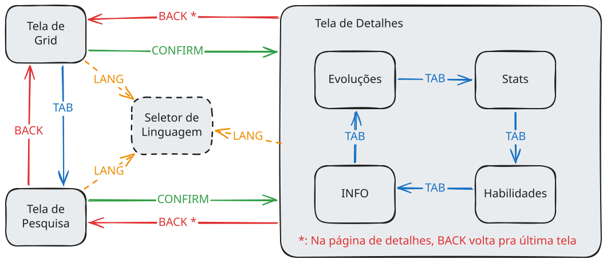

# Fase 1 — Fluxo de Usuário

## Telas

### Painel esquerdo (interativo)

| Tela                              | Conteúdo                                                      | Entra por                                                 | Sai por                            |
| --------------------------------- | ------------------------------------------------------------- | --------------------------------------------------------- | ---------------------------------- |
| **Loading**                       | "LOADING…"                                                    | Início do app / entre saltos                              | Automática, ao carregar            |
| **Grid** (início)                 | Cards (sprite animado, nome, nº), cursor, skeletons           | Fim do Loading; BACK                                      | CONFIRM → Detalhe · TAB → Pesquisa |
| **Pesquisa**                      | Campo de texto, filtro de geração (I–IX), resultados em cards | TAB no Grid                                               | BACK                               |
| **Detalhe** (4 abas)              | INFO · EVOLUÇÃO · STATS · HAB & MOV                           | CONFIRM no Grid/Pesquisa; saltos (evolução, nº do keypad) | BACK (desempilha)                  |
| **Menu de idioma** (sobreposição) | EN / ES / PT-BR / JA                                          | LANGUAGE em qualquer tela                                 | CONFIRM aplica · BACK cancela      |
| **Erro de conexão**               | "CONNECTION ERROR — PRESS CONFIRM TO RETRY"                   | Falha de rede                                             | CONFIRM (retry)                    |

### Painel direito

| Elemento             | Conteúdo                                                                    |
| -------------------- | --------------------------------------------------------------------------- |
| **Secondary screen** | **DESCRIÇÃO** (padrão) ↔ **EFETIVIDADE DE TIPO**; ecoa os dígitos do keypad |
| **Type screens**     | Badges do tipo 1 / tipo 2 do pokémon selecionado                            |

O readout atualiza conforme o cursor se move (lê do cache), até no Grid.

---

## 2. Regras globais

**Escopo por painel**

- Botões da esquerda (D-pad, CONFIRM, BACK, TAB, LANGUAGE) só mexem na tela principal.
- Botões da direita (keypad, LEFT, RIGHT, scroll) só mexem na tela auxiliar.
- **Exceção:** CONFIRM (esquerda) executa o nº digitado no keypad (direita).

**Regra do buffer**

- Se há um nº sendo digitado: **CONFIRM = pular para o pokémon** e **BACK = limpar o buffer** — com prioridade sobre qualquer outra ação desses botões.

**Botões globais** (mesma ação em toda tela carregada)

| Botão        | Ação                                                                                |
| ------------ | ----------------------------------------------------------------------------------- |
| LANGUAGE     | Abre o menu de idioma                                                               |
| Keypad 0–9   | Digita o nº da dex; dígitos aparecem no readout (máx. 4; nº > 1025 recusa com blip) |
| LEFT         | Readout → página DESCRIÇÃO                                                          |
| RIGHT        | Readout → página EFETIVIDADE DE TIPO                                                |
| Scroll L./R. | Rola a página atual do readout ↑/↓                                                  |

**Equivalentes de teclado**

| Teclado         | Botão        |
| --------------- | ------------ |
| Setas           | D-pad        |
| Enter           | CONFIRM      |
| Backspace / Esc | BACK         |
| Tab             | TAB          |
| 0–9             | Keypad       |
| Q / E           | LEFT / RIGHT |
| − / +           | Scroll       |
| L               | LANGUAGE     |

---

## 3. Botões por tela (só o que é específico de cada tela)

### Grid

| Botão   | Ação                                                                              |
| ------- | --------------------------------------------------------------------------------- |
| D-pad   | Move o cursor card a card; ←/→ viram a linha; ↑/↓ na borda auto-scrollam 1 linha  |
| CONFIRM | Abre o pokémon destacado                                                          |
| BACK    | Cicla o filtro de geração (I → II → … → IX → I); a regra do buffer tem prioridade |
| TAB     | Abre a Pesquisa                                                                   |

### Pesquisa

| Botão   | Ação                                                                               |
| ------- | ---------------------------------------------------------------------------------- |
| D-pad   | Navega entre a linha de geração e os resultados (texto é digitado no teclado real) |
| CONFIRM | Confirma o filtro de geração / abre o resultado destacado                          |
| BACK    | Volta ao Grid                                                                      |
| TAB     | Inativo                                                                            |

### Detalhe (4 abas)

| Botão   | Ação                                                                |
| ------- | ------------------------------------------------------------------- |
| D-pad   | Navega o conteúdo da aba; nos switchers: ↓ entra · ←/→ muda · ↑ sai |
| CONFIRM | Confirma o switcher (evolução pula pro membro; forma aplica)        |
| BACK    | Volta à tela anterior (pilha)                                       |
| TAB     | Cicla as abas: INFO → EVOLUÇÃO → STATS → HAB & MOV → INFO           |

### Menu de idioma

| Botão   | Ação                     |
| ------- | ------------------------ |
| D-pad   | Move a seleção de idioma |
| CONFIRM | Aplica e fecha           |
| BACK    | Fecha sem aplicar        |

Nas tabelas acima valem sempre os **botões globais** e a **regra do buffer**. Em **Loading** e **Erro**, só o CONFIRM do _tentar novamente_; o resto fica desligado.

## 4. Grafo de navegação

## 5. Funcionalidades documentadas (por tela)

### Grid

- Cards: sprite animado (Showdown; artwork oficial como fallback estático), nome, nº nacional.
- Cursor: card a card; ←/→ viram a linha (última célula → primeira da linha seguinte); ↑/↓ na borda da área visível auto-scrollam uma linha; linhas viram na horizontal, não na vertical.
- Scroll infinito: mais páginas carregam conforme o cursor chega ao fim; scrollbar oculta (rolagem por mouse/toque continua como extra).
- Skeletons enquanto carrega; readout ao vivo acompanha o cursor.
- BACK cicla o filtro de geração (envolve I→IX→I); a geração ativa aparece no ticker. A linha de geração da Pesquisa continua existindo para escolha direta.
- 1025 espécies padrão; formas alternativas **nunca** aparecem no grid.

### Pesquisa

- Texto livre digitado no teclado real (desktop ou mobile); D-pad **não** digita.
- Combina com: nome no idioma atual, nome em inglês e nº nacional.
- Linha de filtro de geração (I–IX) selecionável por D-pad; pesquisas cobrem todas as gerações até um filtro ser aplicado.
- Resultados reutilizam os cards e o cursor do Grid.

### Detalhe (4 abas)

- **INFO**: sprite animado, nº, nome, gênero ("Pokémon Semente") e o switcher de formas (`‹ Alolan ›`) quando existirem; trocar a forma troca sprite/tipos/stats no app todo.
- **EVOLUÇÃO**: switcher de membros (`‹ Ivysaur ›`) em vez de árvore desenhada; mostra _como_ cada um evolui (nível, item, troca, felicidade, período do dia…); anda também para trás ("evolui de"); CONFIRM pula pro membro; formas só aparecem onde a própria cadeia ramifica.
- **STATS**: 6 barras de atributos base, altura, peso, habilidades; rodapé com habitat, grupos de ovo, taxa de captura e razão de gênero.
- **HABILIDADES & MOVIMENTOS**: 2–3 habilidades com efeito de uma linha; lista de golpes por nível, **apenas da última geração**, com scroll.
- **Cry** do pokémon toca automaticamente ao abrir o Detalhe; beep de confirmação sintetizado em cada CONFIRM.
- As abas lembram a posição ao ciclar e voltar.

### Switchers (padrão único, compartilhado)

`↓` entra · `←/→` muda · `↑` sai · `CONFIRM` confirma.

### Keypad (lookup direto)

- Dígitos compõem o nº nacional no readout; CONFIRM pula; BACK limpa; nº > 1025 recusado com blip curto.

### Menu de idioma

- EN (padrão) / ES / PT-BR / JA; escolha persiste no localStorage; UI traduzida por dicionário; conteúdo traduzido vem da API; pt-BR pré-Gen 7 cai silenciosamente para inglês.

### Estados

- Loading: "LOADING…" em fonte pixel, sem spinners.
- Erro: mensagem informativa com retry por CONFIRM.
- Sem persistência de dados do usuário além do idioma e do cache (enciclopédia somente leitura).
